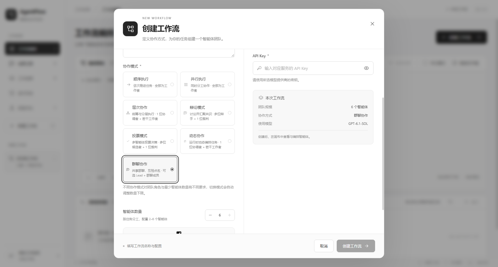
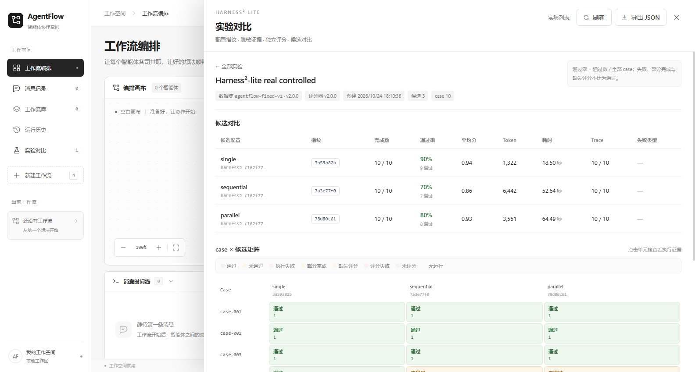
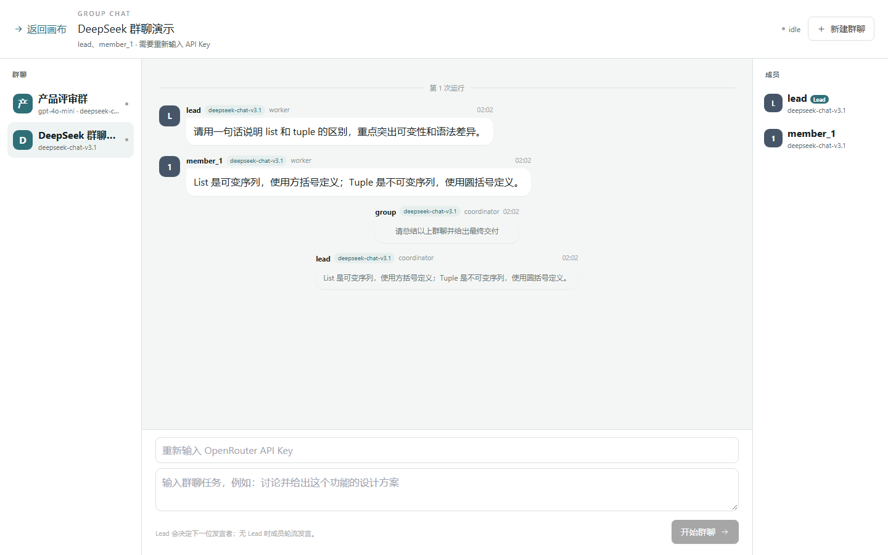
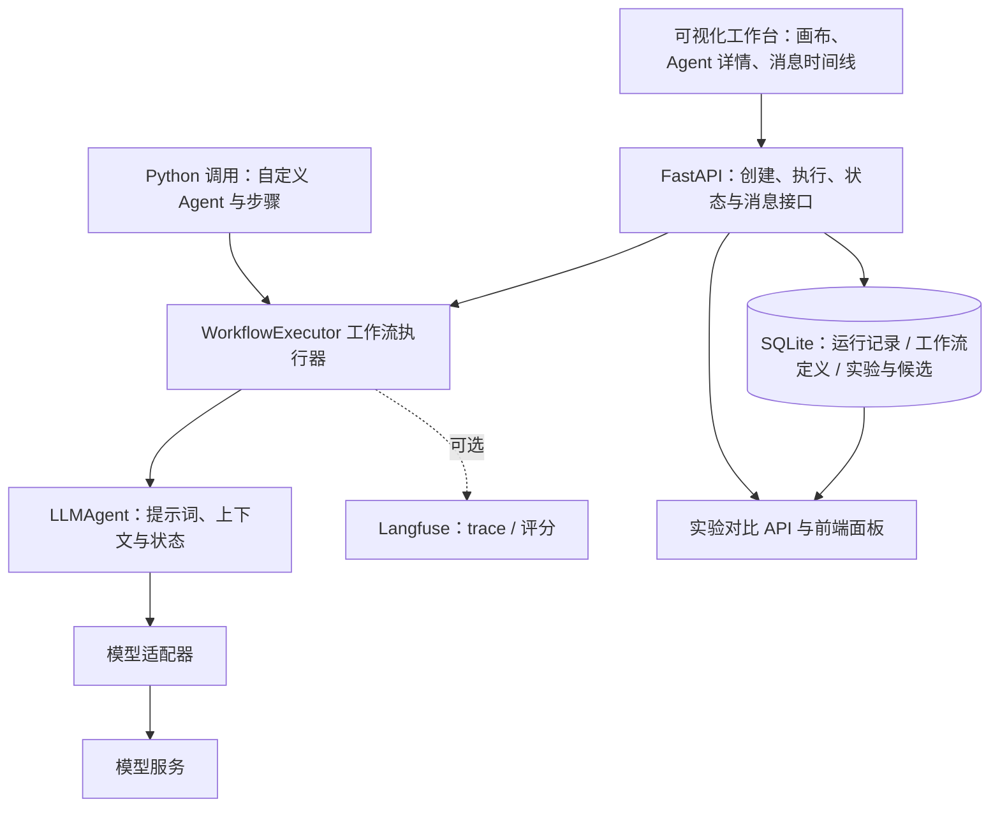
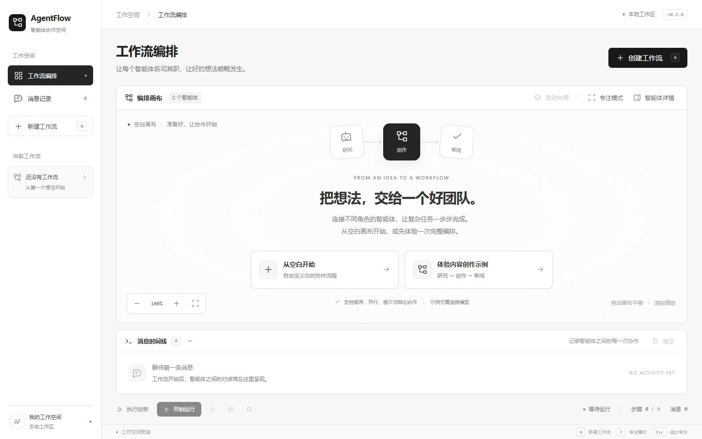

# AgentFlow

**一个轻量、易调试的多 Agent 协作框架。**

AgentFlow 帮助开发者将多个 AI Agent 组织成工作流，让它们按步骤处理任务、传递结果，并查看协作过程中每一步的输入、输出和运行状态。项目包含 Python 工作流引擎、模型适配器、FastAPI 服务，以及用于观察与调试的可视化工作台。

适合用来学习多 Agent 协作、验证任务编排思路，以及开发内容创作、代码审查、分析整理等工作流原型。

## 最新版本亮点（2026-10-25）

- **七种协作模式**：顺序、并行、层次、辩论、投票、动态、群聊；创建时按模式自动分配协调者/工作者/辩手/裁判角色，并校验最低智能体数量。
- **独立群聊导航与工具协作**：群聊列表 + 全屏微信式聊天页；创建时可为每个成员选择不同 OpenRouter 模型，并单独选择 Lead 模型；支持可选 Lead、轮询发言、`@点名`、结构化 handoff；工具层同时支持执行器中介 `ask_agent`/`handoff_to` 与 **OpenAI 兼容原生 function calling（tool_calls）**，工具预算默认 **10 次/轮、30 次/run**（可配置，硬上限 20/60）；群聊消息 SQLite 持久化、重启回放、跨 run 历史与模型徽章；真实模型 2 Agent、单工具、多工具、原生工具与 1s 超时冒烟均通过。
- **运行记录与执行控制**：每次执行独立 run_id，记录步骤输入输出、模型、token、尝试次数、错误类型、trace_id；支持停止、单步超时与有限重试。
- **工作流定义持久化**：本地 SQLite 保存定义（不含密钥），重启恢复，支持导出/导入。
- **可选 Langfuse 追踪与评分**：默认关闭；开启后可在 Langfuse 查看调用树、用量与评分，本地记录里保留 trace_id。
- **Harness²-lite 实验对比**：配置指纹、脱敏执行证据、独立 judge、候选对比报告与前端实验面板；不自动修改工作流。
- **质量状态**：后端 237 个测试、前端 136 个测试；GitHub Actions 的 backend/frontend 两个 job 均通过。

创建七种协作模式：



Harness²-lite 实验对比面板：



独立群聊导航：




## 项目解决什么问题？

在多 Agent 应用中，开发者需要同时处理角色分工、任务顺序、模型调用和结果交接。任务一旦失败，或最终答案不符合预期，往往还需要追溯：哪个 Agent 收到了什么内容，哪一步的输出偏离了要求，以及模型连接是否正常。

AgentFlow 将这些工作拆成可检查的组成部分：用 Agent 配置表达职责，用工作流步骤表达执行顺序，用消息记录输入与输出，再通过可视化工作台观察运行情况。你可以先运行一个简单流程，再根据中间结果调整提示词、模型参数或步骤设计。

项目当前重点是**本地开发、过程观察和协作原型验证**，面向需要理解和调试多 Agent 流程的开发者。界面采用极简黑白风格，让画布、配置与消息内容保持清晰。

## 适合哪些场景？

| 场景 | 可以设计的分工 | 重点观察什么 |
| --- | --- | --- |
| 内容创作 | 提纲 → 初稿 → 审校 | 后续 Agent 是否遵守前一步的结构与写作要求 |
| 代码审查 | 代码分析 → 安全检查 → 性能分析 → 汇总 | 各阶段是否保留代码上下文，结论是否有依据 |
| 分析整理 | 整理用户提供的材料 → 提炼要点 → 形成报告 | 中间结果是否遗漏材料或改变原意 |
| 提示词实验 | 固定任务，修改某个 Agent 的职责或参数后重新执行 | 输出变化来自哪个环节 |
| 多 Agent 学习 | 从两个 Agent 的顺序流程开始逐步增加步骤 | 输入、输出、状态和步骤之间如何关联 |

上表是基于框架可设计的工作流，不代表已经内置了这些专业 Agent。角色和提示词需要自行定义；材料需要由调用者提供，当前没有内置联网搜索、文件检索或自动执行外部工具的完整链路。

## 这个项目能做什么？

- **组织 Agent 分工协作**：通过 Python 定义 Agent 的职责、系统提示词、模型参数和执行步骤，让前一步的结果成为后一步的输入；也可以直接在网页选择七种协作模式之一自动组队。
- **运行协作任务**：通过 Python 调用工作流引擎，或在网页中创建并执行工作流，观察任务如何在多个 Agent 之间推进。
- **检查过程、定位问题**：查看每一步的消息、Agent 状态和模型配置，判断问题发生在任务输入、结果交接还是模型连接环节。
- **比较配置**：在固定数据集上比较不同候选配置，记录指纹、证据与评分，判断改动是否真的有效（Harness²-lite）。

例如，可以设计一个内容创作流程：

```text
写作任务 → 提纲 Agent → 初稿 Agent → 审校 Agent → 最终稿
```

运行后，逐步检查提纲、初稿和审校结果，再调整对应 Agent 的提示词或模型参数。网页创建时会按所选协作模式自动分配通用角色；需要自定义角色提示词时，通过 Python 配置或导入定义实现。仓库中的 [代码审查示例](examples/code_review.py) 展示了如何配置多个不同职责的 Agent 和步骤。

## 核心概念与协作原理

| 概念 | 在项目中的作用 |
| --- | --- |
| `AgentConfig` | 描述一个 Agent 的名称、角色、系统提示词、模型、温度和输出长度等参数 |
| `LLMAgent` | 根据配置调用模型、维护自身的近期消息上下文，并记录处理状态与使用统计 |
| `Message` | 表达一次任务或响应，包含发送方、接收方、内容、时间及元数据 |
| `WorkflowStep` | 指定某一步由哪个 Agent 处理 |
| `WorkflowConfig` | 将 Agent 配置、执行模式与步骤列表组合成一个工作流 |
| `WorkflowRun` | 一次实际执行的运行记录：run_id、任务输入、配置快照、起止时间、终态、步骤结果与用量 |
| `StepResult` | 单步记录：步骤序号、Agent、输入输出、模型、状态、错误、时间与用量类型 |
| `WorkflowExecutor` | 注册 Agent、执行步骤、保存消息历史并触发事件回调；同一时刻只允许一个运行 |
| 模型适配器 | 将 Agent 的模型请求交给对应服务商，便于将编排逻辑与具体接口分开 |
| 追踪（可选） | 本地运行记录之外，可通过 Langfuse 观察执行树与评分；默认关闭且默认不上传业务内容 |

### 七种协作模式

| 模式 | 执行流程 | 最低智能体 |
| --- | --- | --- |
| 顺序执行 | 按步骤依次传递，失败即停 | 1 |
| 并行执行 | 同时独立执行，记录成功/部分失败/全部失败 | 1 |
| 层次协作 | 协调者规划 → 工作者执行 → 协调者汇总 | 2 |
| 辩论模式 | 多辩手两轮讨论（第二轮互看观点）→ 裁判综合 | 3 |
| 投票模式 | 多候选独立作答 → 裁判比较裁决 | 3 |
| 动态协作 | 协调者逐轮选择工作者，最多 max_iterations 轮 → 汇总 | 2 |
| 群聊协作 | 共享群聊记录；创建时可选择每个成员的 OpenRouter 模型和独立 Lead 模型；全屏微信式聊天页；可选 Lead、轮询 + `@点名` / 结构化 handoff；支持 `ask_agent` / 原生 function calling，工具预算默认 10 次/轮、30 次/run（可配） | 2（最多 6） |

网页创建时会按模式自动分配 coordinator / worker / reviewer 角色；群聊模式可选 Lead 或纯成员群聊。更低层的执行语义、停止/重试/记录边界见 [开发指南](docs/development.md) 与 [当前限制](docs/limitations.md)。

以当前已接通的顺序执行为例：

1. 接收初始任务，将任务正文交给步骤列表中的第一个 Agent。
2. Agent 结合自己的系统提示词、近期上下文和本次输入调用模型。
3. 执行器保存本步骤的任务与响应，并触发步骤完成事件。
4. 将本步骤的响应正文交给下一个 Agent，重复处理直到步骤结束。
5. 返回最后一步的结果，并保留消息历史，供检查和调试。

**顺序执行按步骤列表依次传递文本。** 后续 Agent 默认收到的是前一步的输出，不会自动获得所有前序 Agent 的完整记录。如果后续步骤还需要原始材料、目标或约束，应在提示词中要求前一步保留并交接这些内容。画布中的连线用于展示顺序关系，拖动节点主要调整显示位置。

## 系统如何组成？



前端使用 Vue 3、Pinia 和 Vue Flow 展示当前工作流，并轮询后端获取执行状态与消息。后端负责工作流编排和模型调用；Python 开发者也可以直接使用引擎，不必经过网页。网页创建的定义会持久化到本地 SQLite（不含密钥），运行记录同样保存在 SQLite（默认 `backend/agentflow_data.db`），刷新页面或重启后仍可查看历史运行；可选追踪会额外写入 Langfuse。

## 为什么易调试？

- **消息过程可见**：工作流记录各步骤的任务与响应；网页时间线显示发送方、接收方、时间和消息正文，可自由调整高度以阅读长输出。
- **配置与状态可查**：点击画布节点，检查 Agent 的角色、系统提示词、模型参数、运行状态和消息统计。
- **调用错误可定位**：界面展示模型调用失败信息，对密钥与提供商不匹配等常见问题提供修正提示。
- **便于接入自己的调试逻辑**：Python 执行器提供事件回调，可在步骤完成时记录结果与耗时；FastAPI 的 `/docs` 页面便于检查接口请求和响应。

### 一次典型的调试过程

1. **先检查连接**：在创建工作流时确认提供商、模型和 API Key 对应，使用一个简短任务验证调用。
2. **查看第一个出现偏差的步骤**：在消息时间线中对照该步骤的任务和响应，检查输入是否完整、输出是否符合职责。
3. **核对 Agent 配置**：查看系统提示词、所用模型和参数，确认角色是否清楚、输出长度是否足够。
4. **调整并重新运行**：网页可修改任务、重新配置模型并重新执行；专用角色提示词可通过 Python 配置或导入定义调整。
5. **用事件回调补充记录**：需要更细的开发日志时，可订阅步骤开始、步骤完成，以及工作流的开始、完成、异常事件。

| 遇到的问题 | 优先检查的位置 | 可尝试的调整 |
| --- | --- | --- |
| 请求被拒绝、出现认证错误 | 页面错误提示与模型连接设置 | 核对提供商、Key、模型权限及接口地址 |
| 后续 Agent 偏离原始目标 | 上一步响应与当前步骤输入 | 在交接内容中保留原始目标、材料和约束 |
| 某一步输出过短或格式不一致 | Agent 提示词与 `max_tokens` | 明确输出格式，调整长度上限后重新验证 |
| 多个 Agent 反复输出相似内容 | 各 Agent 的职责与系统提示词 | 为每一步指定清晰且不同的目标 |

这里的“易调试”主要指**输入输出可观察、配置可检查、事件可接入**。目前还不提供完整的断点、单步、执行回放或自动重试系统。

- **运行记录可回看**：每次执行生成独立 run_id，记录任务输入、配置快照、步骤输入输出、模型、状态、错误、耗时和用量类型；刷新页面后可从「运行历史」重新读取。
- **失败与停止语义真实**：必需步骤失败会停止后续步骤，失败内容不会作为正常材料继续传递；并行失败会区分全部成功/部分失败/全部失败；停止会阻止后续调用并标记已取消步骤。

当前支持 **顺序、并行、层次、辩论、投票、动态、群聊** 七种模式；群聊为受控共享 transcript（可选 Lead、最多 6 人），已接入执行器中介工具与原生 function calling（工具预算可配）；尚未接入自动 RSI；实验数据集仍以顺序/并行配置为主。其他限制见 [当前限制](docs/limitations.md)。

## 可视化工作台

工作台采用极简黑白界面，提供工作流画布、Agent 详情和消息时间线，便于在本地观察执行过程。



## 当前功能

- 智能体画布：拖动、缩放、自动布局、详情检查与专注模式。
- 工作流创建与执行：任务输入、状态同步、步骤进度、模型错误提示；支持顺序、并行、层次、辩论、投票、动态、群聊七种协作模式。
- 独立群聊导航：左侧「群聊」入口进入全屏群聊页；群聊列表 + 微信式消息气泡、头像、模型徽章、成员面板、可选 Lead、轮询发言、@点名、结构化 handoff、停止与跨 run 历史回看。
- 工作流定义持久化：重启后端后定义自动恢复；密钥不落库，恢复的工作流需要重新输入 API Key 才能执行。
- 定义导入/导出：可导出工作流定义为版本化 JSON，或导入定义生成新工作流（导入后同样需要提供密钥）。
- 运行历史：每次执行独立 run_id，可查看状态、步骤输入输出、模型、token、尝试次数、错误类型与 trace_id；支持按状态筛选与导出 JSON；刷新页面后从本地记录重新读取。
- 停止执行：执行中可直接「停止运行」；顺序模式阻止后续步骤，并行模式取消未完成调用；stopped 不会显示成成功。
- 执行控制：可选单步超时与有限重试（默认关闭/1 次，仅超时/限流/网络/服务端错误重试）；多次尝试用量按已知部分累计。
- 工作流删除：二次确认、运行中拦截、清理对应消息与本地选择。
- 消息时间线：拖动底边调整高度、键盘微调、双击恢复与高度记忆。
- 模型连接：提供商选择、OpenRouter 密钥匹配检查。
- 本地编排示例：不调用真实模型，便于先体验界面。
- 可选追踪与评分：Langfuse 默认关闭；开启后可查看调用树，并可选择自动评估写入评分（默认不外发业务内容）。
- 实验对比（Harness²-lite）：固定数据集下比较不同候选配置，记录配置指纹、脱敏执行证据、独立 judge 结果，并在「实验对比」面板查看候选表/case 矩阵/证据；不自动改工作流。
- 可选本地 API Token：设置 `AGENTFLOW_API_TOKEN` 后 /api 请求需 Bearer Token；默认不启用，仅适合本地/受信环境。

## 两种使用方式

| 方式 | 适合做什么 | 需要了解的边界 |
| --- | --- | --- |
| 网页工作台 | 快速创建工作流、连接模型、执行任务、检查 Agent 与阅读消息 | 七种模式会自动分配角色；不是完整的提示词/角色编辑器 |
| Python 框架 | 定义专用角色、系统提示词和步骤，接入事件回调或自定义适配器 | 需要编写配置代码；独立运行的数据不会自动接入网页 |

### 先通过网页体验

完成下方安装并启动服务后，打开工作台：

1. 可以先加载本地编排示例，了解画布与详情面板；该示例不调用真实模型。
2. 创建自己的工作流，填写名称，选择七种协作模式之一；智能体数量会按模式自动调整（顺序/并行 1，层次/动态 2，辩论/投票 3，群聊 2–6），再选择提供商和模型。
3. 填入对应提供商的 API Key，并确认任务输入。
4. 开始运行，在画布中观察 Agent 状态，在时间线中阅读步骤消息与结果。
5. 拖动时间线底边扩大阅读区域；也可使用键盘微调高度，双击恢复默认大小。

### 通过 Python 定义专用协作流程

[代码审查示例](examples/code_review.py) 配置了代码分析、安全检查、性能分析和最终汇总四个 Agent，展示了以下用法：

- 用 `AgentConfig` 分别定义职责、系统提示词与模型参数。
- 用 `WorkflowStep` 列出执行顺序，并组成 `WorkflowConfig`。
- 创建适配器，将各个 `LLMAgent` 注册到执行器。
- 监听 `step_completed`，记录该步骤的结果和耗时。
- 调用 `await executor.execute(task)`，读取最终结果和消息统计。

先安装后端包，再在自己的终端设置 `OPENAI_API_KEY` 与 `OPENAI_MODEL`，从项目根目录运行：

```bash
python examples/code_review.py
```

这个示例会调用真实模型并产生对应服务商的使用量。示例中的顺序流程同样只把前一步响应传给下一步；用于更严谨的多专家审查时，还需要自行设计原始代码、各阶段意见与最终汇总的交接格式。

## 本地启动

### 获取代码

```bash
git clone https://github.com/yezhi-0430/AgentFlow.git
cd AgentFlow
```

需要 **Python 3.11+、Node.js 22.13+（22.x）或 24+ 和 npm**。在项目根目录安装依赖：

### Windows PowerShell

```powershell
python -m venv backend/.venv
backend/.venv/Scripts/python.exe -m pip install -e "./backend[dev]"
cd frontend
npm ci
cd ..
python scripts/dev.py --check
python scripts/dev.py
```

完成安装后，也可以双击根目录的 `start.bat`。

### macOS / Linux

```bash
python3 -m venv backend/.venv
backend/.venv/bin/python -m pip install -e "./backend[dev]"
cd frontend
npm ci
cd ..
python3 scripts/dev.py --check
bash start.sh
```

前端：[http://localhost:5173](http://localhost:5173)
后端文档：[http://localhost:8000/docs](http://localhost:8000/docs)

在启动终端按 **Ctrl+C** 停止本项目启动的服务。端口被占用时，启动器会提示并退出；它不会停止其他 Python 或 Node 进程。

如需更换端口：

```bash
python scripts/dev.py --backend-port 8002 --frontend-port 5176
```

## 模型连接

在页面创建工作流时输入提供商对应的 API Key。使用 OpenRouter 密钥时选择 **OpenRouter**；模型 ID 也应使用该平台支持的格式。

密钥只用于当前后端进程中的模型调用，不写入 Git、浏览器持久存储、运行记录或 Langfuse。工作流定义持久化在本地 SQLite（不含密钥），后端重启后定义会恢复，但执行恢复的工作流时需要在页面重新输入 API Key；不要将当前无鉴权的后端直接部署到公网。

前端 API 地址可选配置在 `frontend/.env`，模板见 [frontend/.env.example](frontend/.env.example)。`VITE_` 变量会进入浏览器代码，不能用来存放模型密钥。

### 服务商支持情况

| 连接方式 | 当前说明 |
| --- | --- |
| OpenAI | 通过对应适配器调用官方接口，使用有权限访问的模型与官方 Key |
| OpenRouter | 使用 OpenRouter Key 和其支持的模型 ID，页面会检查常见的 Key 与提供商不匹配问题 |
| DeepSeek | 有对应适配器；模型名称和可用权限应以自己的服务商账号为准 |
| Claude | 当前适配器走 OpenAI 兼容接口，默认地址为 OpenRouter，尚非完整的 Anthropic 原生接入 |
| 本地模型 | 当前尚未接入，页面会提示暂不支持 |

模型下拉选项是配置快照，不保证所有账号都能调用。切换服务商时，需要同时核对 Key、模型 ID 和接口地址。

## 当前能力与边界

| 能力 | 当前状态 |
| --- | --- |
| 顺序工作流 | 已接通创建、执行、步骤状态、消息与运行记录；失败即停 |
| 并行工作流 | 已接通全部成功/部分失败/全部失败/停止取消的记录与状态 |
| 层次协作 | 协调者规划 → 工作者执行 → 协调者汇总；至少 2 个智能体（1 协调 + 1 工作者） |
| 辩论模式 | 多辩手两轮讨论（第二轮互看观点）→ 裁判综合；至少 3 个智能体（2 辩手 + 1 裁判） |
| 投票模式 | 多候选独立作答 → 裁判比较裁决；至少 3 个智能体（2 候选 + 1 裁判） |
| 动态协作 | 协调者逐轮选择工作者，最多 `max_iterations` 轮，最后汇总；至少 2 个智能体（1 协调 + 1 工作者） |
| 群聊协作 | 共享群聊记录；可选 Lead 分派/总结，或成员 round-robin + `@点名` / 结构化 handoff / `ask_agent` 工具协议；独立群聊导航；消息持久化（重启回放）；工具预算默认 10 次/轮、30 次/run（可配）；2–6 个智能体，最多 20 轮 |
| 运行实例与记录 | 每次执行独立 run_id；本地 SQLite 持久化，schema v4，刷新后可回看 |
| 工作流定义 | 本地 SQLite 持久化（schema v1，不含密钥），重启后恢复；支持定义导出/导入 |
| 执行控制 | 停止按钮/停止接口；可选单步超时与有限重试；错误类型与尝试次数记录；失败不重试鉴权错误 |
| 密钥与执行 | 密钥只在内存；重启/导入后的工作流执行时需重新提供 API Key |
| 评测 | 10 个固定 case + 确定性评分 + 一次受控真实模型实验（30 次执行，样本有限，不外推质量结论） |
| Harness²-lite | 配置指纹、脱敏证据（默认关闭/90 天）、独立 judge（≤50 次/轮）、候选对比报告与前端实验面板；真实实验一次受控运行 |
| 追踪关联 | Langfuse 可选；run 记录/实验 case 带 trace_id，未启用时为 null |
| 测试与 CI | 后端 237、前端 136 个测试；GitHub Actions backend/frontend 两个 job 通过 |
| 本地访问控制 | 可选 `AGENTFLOW_API_TOKEN`（Bearer）；默认关闭，不替代生产鉴权 |
| 团队或公网部署 | 尚无完整鉴权、多用户隔离，需要进一步开发 |

更详细的说明见 [当前限制](docs/limitations.md)，第一批优化见 [第一批优化实施报告](docs/BATCH_1_OPTIMIZATION.md)，工作流定义持久化见 [第二批第 1 项报告](docs/BATCH_2_REPORT.md)，第二批其余事项见 [第二批剩余事项报告](docs/BATCH_2B_REPORT.md)，实验数据见 [实验报告](docs/EXPERIMENTS_REPORT.md)。

## Docker

```bash
docker compose up --build
```

同样访问 5173 和 8000 端口。Compose 仅将端口映射到本机回环地址，按 Ctrl+C 停止。停止后台容器可运行 `docker compose down`。此配置用于本地体验与开发，不包含生产环境的鉴权、持久化或反向代理。

## 检查

```bash
# 项目根目录；先完成后端开发依赖安装
backend/.venv/Scripts/python.exe -m pytest backend/tests -q
# macOS / Linux 使用 backend/.venv/bin/python

cd frontend
npm run lint
npm test
npm run build

# 实验入口与基线（默认假模型，不联网、不产生费用）
cd backend
python scripts/run_experiment.py --config all
python scripts/run_baseline.py   # 重新生成 docs/BASELINE_REPORT.md
```

前端测试使用 Node 自带测试运行器；后端测试使用模拟模型，不消耗 API 额度。GitHub Actions 会运行同样的基础检查（backend：pytest + 假模型实验冒烟 + wheel + check_repo；frontend：lint + test + build）。当前后端 237、前端 136 个测试，数字与最近一次基线见 [基线报告](docs/BASELINE_REPORT.md)。

## 项目结构

```text
backend/              FastAPI、工作流引擎、模型适配器、本地运行记录与 API 测试
frontend/             Vue 3、Vite、Pinia、Vue Flow 与前端回归测试
examples/             Python API 使用示例
experiments/          固定数据集、冻结配置、预期答案与评分规则（版本化）
scripts/              跨平台启动、实验运行器与上传前检查
docs/                 开发、限制、基线与整理说明
.github/workflows/    自动检查
```

- [开发指南](docs/development.md)
- [当前限制](docs/limitations.md)
- [第一批优化实施报告](docs/BATCH_1_OPTIMIZATION.md)
- [第二批第 1 项：工作流定义持久化与导入导出](docs/BATCH_2_REPORT.md)
- [第二批剩余事项（执行控制/评测/关联/存储/安全/前端）](docs/BATCH_2B_REPORT.md)
- [实验报告](docs/EXPERIMENTS_REPORT.md)
- [Harness²-lite 实施报告](docs/HARNESS2_LITE_REPORT.md)
- [群聊真实模型冒烟](docs/GROUP_CHAT_SMOKE.md)
- [群聊多模型与全屏页冒烟](docs/GROUP_CHAT_MULTIMODEL_SMOKE.md)
- [群聊模型目录与特点](docs/MODEL_CATALOG.md)
- [Harness²-lite 设计/决策清单](docs/HARNESS2_LITE_PLAN.md)
- [Harness²-lite 假模型对比](docs/HARNESS2_COMPARISON.md)
- [Harness²-lite 真实模型对比（一次受控）](docs/HARNESS2_REAL_COMPARISON.md)
- [基线报告](docs/BASELINE_REPORT.md)
- [Langfuse 追踪说明](README_LANGFUSE.md)
- [上传 GitHub](docs/github.md)
- [本次整理说明](docs/cleanup.md)

## License

沿用项目原有的 [MIT License](LICENSE)，保留原作者声明。
